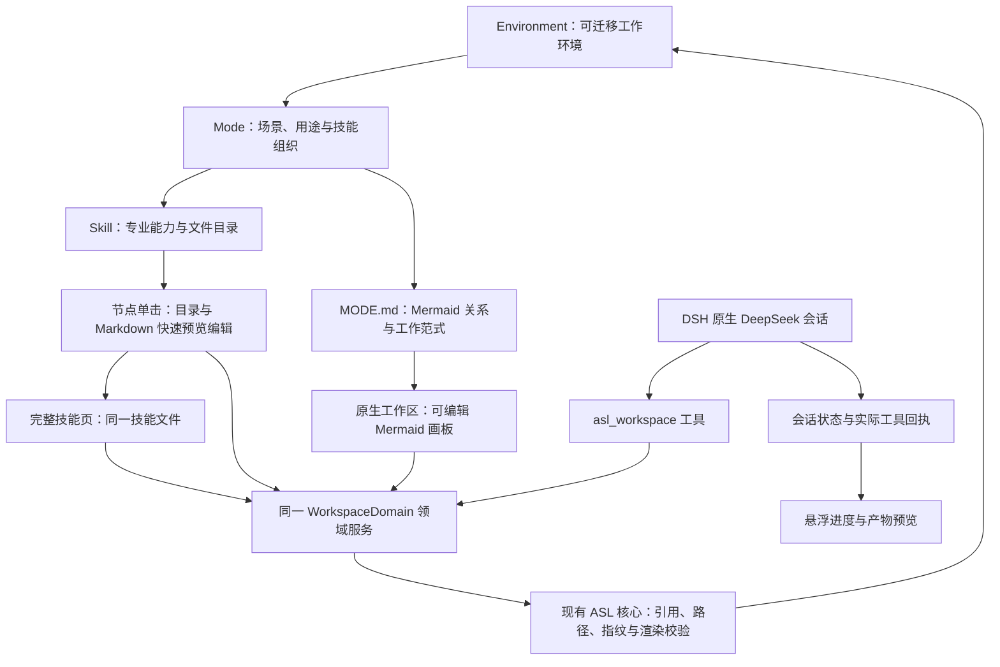

# DSH ASL：架构与实现边界

本插件将 ASL Harness 的个人工作环境投影到 DeepSeek Harness。ASL 的 Environment、Mode、Skill 和内容文件仍是工作真源；DSH 提供会话、模型、工具执行及权限界面。插件不建立第二套 Agent 引擎。

## 从使用者到文件

你在画板里改一个节点，或让 DeepSeek 修改当前文件，最后都由同一服务交给 ASL 核心写入 Environment。界面保存的是当前工作内容；宿主继续负责对话和执行。这里的“投影”指工作区呈现和受控文件访问，不等于自动完成 ASL 所有宿主适配。

## 必须保持的设计约束

- Mode 是工作场景与技能组织，不是自动运行的 DAG。Mermaid 边说明材料、能力或业务关系，不冒充任务执行状态。用途匹配唯一时可选取 Mode，歧义时保留用户选择。
- 进入 Mode 直接显示其原有画板。一个节点关联一至两个技能；单击即可侧栏预览与轻量编辑；打开技能进入完整文件页，返回后继续上级画板。既有分支和不同 Mermaid 图型按原文保留。
- `MODE.md` 是图关系真源，Skill 原目录保存正文、脚本和资源。没有原生 Mermaid 的旧 Mode 通过已有 APP 投影显示，首次编辑才落盘；不另建工作流数据库。
- UI 与 Agent 走同一领域服务。界面草稿和落盘版本分离；Agent 使用 `context → read → save`，提交上下文修订号与原文指纹。目标切换、未保存草稿或并发变化拒绝旧写入；成功回执来自实际保存。
- DSH 原生会话承担底部输入和右侧回复，权限与模型属于宿主。该工具契约不限制宿主其他工具直接访问文件，不能声称提供文件系统沙箱。
- 技能发现沿用现有搜索、仓库检查和采用接口，来源保留；下载不运行安装脚本。采用技能与更新图的操作逐项生效，不能声称是跨文件原子事务。
- 共享 Mermaid 编辑器与 ASL APP 使用同一份实现。视觉由 Stitch 生成，技术修复不得引入第二套视觉系统或修改业务内容。

## 当前能力与后续愿景

| 目标 | 当前实现 |
| --- | --- |
| Mode 组织与自动选择 | 读取现有环境；名称和用途匹配，不宣称模型规划器 |
| 技能画板与内容编辑 | Mermaid 编辑、拖拽、连接、快捷键、撤销；完整文件树、Markdown 阅读编辑 |
| DeepSeek 直接修改 | 原生会话与共享工具；上下文、指纹、草稿保护及保存后刷新 |
| 执行与产物预览 | 读取当前会话实际工具事件；验证文件存在后预览，联动可选 Better Sidebar；没有第二份执行日志 |
| 专业技能发现与采用 | 搜索、仓库检查与采用工具；画框传递范围给原生会话 |
| 实时填入节点 | 每次工具成功保存后刷新，不是模型 token 级流式生成整张图 |
| 通用业务流转协议 | 复用 ASL 对象、引用与文件校验；跨系统自动调度、通用事务协议仍属后续目标 |

## 与 ASL 总体框架怎样衔接

| ASL 框架部分 | 本插件怎样使用 |
| --- | --- |
| Profile、正式 Skill Pool、Mode 与依赖闭包 | 连接已有 Environment，通过核心读取目录；不复制另一份业务库 |
| Mode 的能力边界 | 用于工作区选择、技能组织和当前会话上下文；切换 Mode 不会自动重写 DSH 全局 Skill 发现目录 |
| 核心 Guard | 复用内容保存的路径、引用、指纹与 Mermaid 校验；不把它扩称宿主全部工具的安全边界 |
| 来源与采用 | 搜索、固定来源下载、检查及采用现有 Skill 包；来源升级和完整维护能力仍由 ASL 主框架提供 |
| Git 与培养区 | 保持原文件和已有核心规则；插件不新增自动跨机同步、后台自我培养或独立审阅系统 |
| Case 与业务产物 | 围绕当前 Mode 和 Skill 文件工作；不会因为 Mode 里有业务连线，就自动生成跨应用任务调度器 |

Environment 由使用者维护。插件读写的三个本地路径来自 profile 配置；运行依赖及第一次使用步骤见 [安装指南](docs/INSTALLATION.md)。共享客户端源码固定在 `upstream`，构建从该目录取源码，维护约定见 [UPSTREAM.md](UPSTREAM.md)。

初始愿景、实际能力与验收证据分别记录，不将愿景标成已实现。ASL 总体架构见 [架构真源](https://github.com/qihangzhang-272/asl-harness/blob/39a4735a8ba7c689c10581b517e075ad56fbde8c/docs/asl-architecture-views.md)。独立 `dsh-asl` 仓库是本插件的公开分发入口，核心继续依赖 ASL Harness。

只读 inspection 不授权改写技能；进入预览内编辑后，该文件才成为当前写入目标。预览与完整页共用原有指纹、上下文修订号及草稿门禁。正常业务正文写入会话项目，保存后登记 artifact。产物预览不显示技能/Mode 定义、秘密文件或越界路径。
