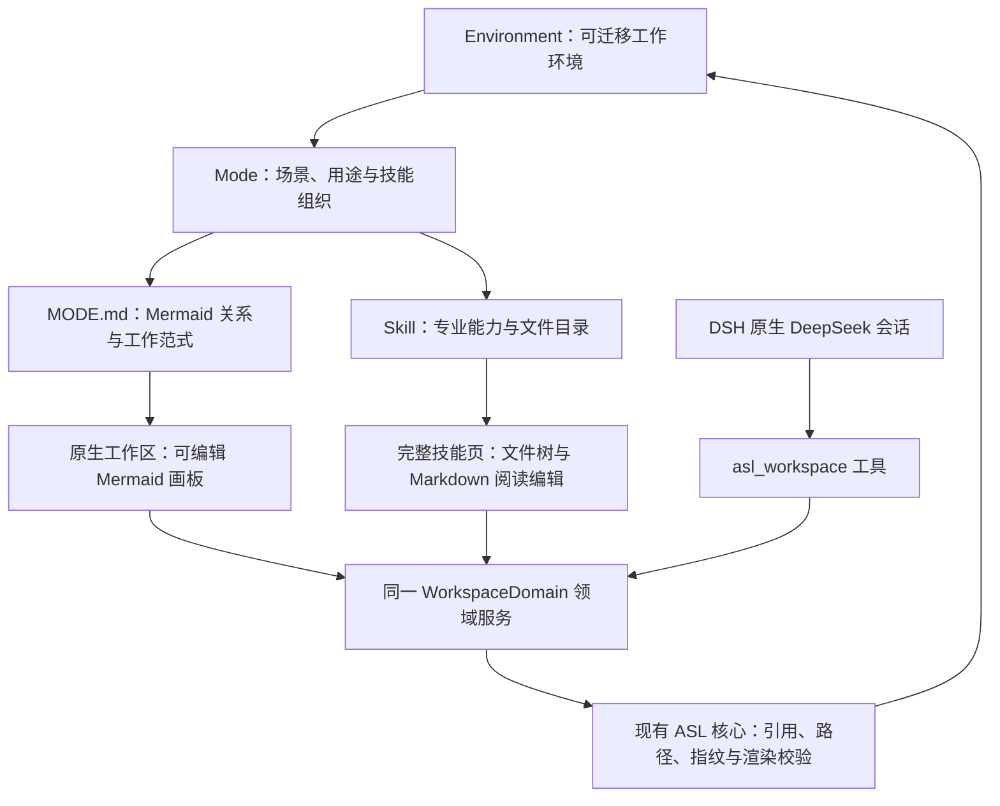

# DSH ASL：架构与实现边界

本插件将 ASL Harness 的个人工作环境投影到 DeepSeek Harness。ASL 的 Environment、Mode、Skill 和内容文件仍是工作真源；DSH 提供会话、模型、工具执行及权限界面。插件不建立第二套 Agent 引擎。

## 必须保持的设计约束

- Mode 是工作场景与技能组织，不是自动运行的 DAG。Mermaid 边说明材料、能力或业务关系，不冒充任务执行状态。用途匹配唯一时可选取 Mode，歧义时保留用户选择。
- 进入 Mode 直接显示其原有画板。一个节点关联一至两个技能；打开技能进入完整文件页，返回后继续上级画板。既有分支和不同 Mermaid 图型按原文保留。
- `MODE.md` 是图关系真源，Skill 原目录保存正文、脚本和资源。没有原生 Mermaid 的旧 Mode 通过已有 APP 投影显示，首次编辑才落盘；不另建工作流数据库。
- UI 与 Agent 走同一领域服务。界面草稿和落盘版本分离；Agent 使用 `context → read → save`，提交上下文修订号与原文指纹。目标切换、未保存草稿或并发变化拒绝旧写入；成功回执来自实际保存。
- DSH 原生会话承担底部输入和右侧回复，权限与模型属于宿主。该工具契约不限制宿主其他工具直接访问文件，不能声称提供文件系统沙箱。
- 技能发现沿用现有搜索、仓库检查和采用接口，来源保留；下载不运行安装脚本。采用技能与更新图的操作逐项生效，不能声称是跨文件原子事务。
- 共享 Mermaid 编辑器与 ASL APP 使用同一份实现。视觉由 Stitch 生成，技术修复不得引入第二套视觉系统或修改业务内容。

## 当前能力与后续愿景

| 目标 | 当前实现 |
| --- | --- |
| Mode 组织与自动选择 | 读取现有环境；名称和用途匹配，不宣称模型规划器 |
| 技能画板与内容编辑 | Mermaid 编辑、拖拽、连接、快捷键、撤销；完整文件树、Markdown 阅读编辑 |
| DeepSeek 直接修改 | 原生会话与共享工具；上下文、指纹、草稿保护及保存后刷新 |
| 专业技能发现与采用 | 搜索、仓库检查与采用工具；画框传递范围给原生会话 |
| 实时填入节点 | 每次工具成功保存后刷新，不是模型 token 级流式生成整张图 |
| 通用业务流转协议 | 复用 ASL 对象、引用与文件校验；跨系统自动调度、通用事务协议仍属后续目标 |

初始愿景、实际能力与验收证据分别记录，不将愿景标成已实现。ASL 总体架构见 [架构真源](https://github.com/qihangzhang-272/asl-harness/blob/39a4735a8ba7c689c10581b517e075ad56fbde8c/docs/asl-architecture-views.md)。独立 `dsh-asl` 仓库是本插件的公开分发入口，核心继续依赖 ASL Harness。
