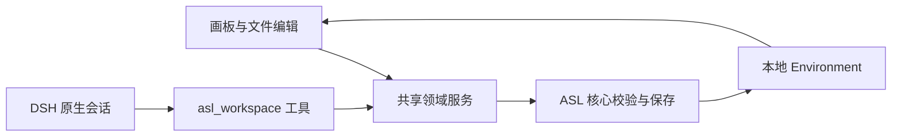

<p align="right"><strong>简体中文</strong> · <a href="README_EN.md">English</a></p>

<h1 align="center">dsh-asl</h1>

<p align="center"><strong>把技能放回工作场景里，在 DeepSeek Harness 中接着做事。</strong></p>

<p align="center">
  <a href="https://github.com/qihangzhang-272/dsh-asl/releases"></a>
  <a href="https://github.com/qihangzhang-272/dsh-asl/actions/workflows/check.yml"></a>
  <a href="LICENSE"></a>
</p>

<p align="center"><a href="#为什么做这个插件">为什么需要它</a> · <a href="#先看一遍怎么用">怎么用</a> · <a href="#开始使用">开始使用</a> · <a href="ARCHITECTURE.md">架构</a> · <a href="docs/INSTALLATION.md">安装与排错</a></p>

你可能已经存了不少 Skill。真正开始工作时，还要想一遍：这次该用哪几个，材料放在哪里，上次调整过的方法能不能接着用。

**dsh-asl 把 ASL Harness 的工作环境带进 DeepSeek Harness。** 用 Mode 整理一种反复要做的工作，在画板上看清技能怎样配合；打开节点里的技能，阅读和修改它的文件。需要 DeepSeek 帮忙时，就在当前页面继续对话。


*Creator Studio 示例画板，来自实际插件组件。显示哪些技能，由你连接的 Environment 决定。*

## 为什么做这个插件

一篇公众号稿可能要用到资料核查、作者采访、写作、配图和排版；投研工作也有自己的材料、判断方式和工具。把这些能力平铺在同一个目录里，时间一长，找得到文件也未必记得该怎么配合。

ASL 用 **Mode** 保存这样的工作场景。dsh-asl 给它一个可以直接操作的工作区：技能关系、文件和原生 DeepSeek 对话放在同一条使用路径里。写过的内容留在自己的文件夹中，下次进入这个 Mode，还能从这里继续。

它延续 [ASL Harness](https://github.com/qihangzhang-272/asl-harness) 的分工：ASL 管工作环境和内容，DeepSeek Harness 管模型、会话与工具执行。已有的 ASL 技能库可以直接连接。

## 先看一遍怎么用

以“把投研材料整理成公众号文章”为例，你可以在自己的内容创作 Mode 中这样工作：

1. **进入场景。** 手动选择 Mode，或输入这次的目标，让工作区按现有 Mode 的名称和用途匹配；有歧义时自己选。
2. **看清关系。** 进入后就是 Mermaid 技能画板。单击选中，双击改名；拖动节点、连接技能，或直接编辑 Mermaid 原文。
3. **打开内容。** 点节点旁的「打开技能 ↗」，或按 `Ctrl+Enter`，进入完整文件页。左边是文件树，右边可以阅读、编辑 Markdown；返回后回到上级画板。
4. **交给 DeepSeek。** 在底部原生输入框说明要改哪里、改成什么。工作区把当前文件和选区提供给会话，DeepSeek 通过共享工具读取、保存，界面再显示实际写入的结果。
5. **需要新能力时再找。** 在画板上画框，把范围交给右侧会话，协助查找、检查和采用技能。每次成功保存后，画板随之更新。

这个例子需要你自己的研究与创作技能。仓库附带的起步样例只包含产品分析和资料研究，用来熟悉安装与操作。

## Mode、Skill 和画板，分别是什么

| 对象 | 你会用它做什么 | 保存在什么地方 |
| --- | --- | --- |
| Environment | 长期保存自己的技能与工作场景 | 一个普通的本地文件夹 |
| Mode | 组织一种反复进入的工作状态，如研究、创作或产品分析 | `modes/<mode-id>/` |
| Skill | 保存某项专业能力的说明、脚本、模板和参考资料 | `skills/<skill-id>/` |
| Mermaid 画板 | 看见、调整技能关系与常用工作范式 | Mode 的 `MODE.md`；成员配置在 `mode.yaml` |
| DeepSeek 会话 | 围绕当前内容提出目标、查找资料和执行修改 | DeepSeek Harness 原生会话 |

一条连线可以表示“这些材料供下一项技能使用”，也可以表示补充研究、分支或反馈。Agent 按当前任务选择怎么做，图本身不保存任务运行状态。多个 Mode 可以引用同一项 Skill，修改时仍落在同一份文件上。

## 开始使用

当前公开版为 **0.3.15**，已在 **Windows x64、官方 DSH 0.2.1-rc.5** 验收。macOS／Linux 原生宿主尚未实测。宿主兼容声明为 `>=0.2.1-rc.5 <0.3.0-0`，这个范围不代表每个版本都已实测。商店／GitHub 直装后即使未配置本地路径，也能安全挂载；首次打开会提示准备 ASL 仓库和 Environment。实际读写仍需完成下面的配置。下面走 Windows 路径；完整解释和故障处理见[安装指南](docs/INSTALLATION.md)。

安装需要四样东西：能正常打开的 DeepSeek Harness、Git、完整的 ASL 源码目录，以及 ASL 核心程序。使用下面的便携核心时，普通使用者不需要另装 Python 或构建插件。

### 1. 下载源码和核心

先打开一次 DSH 桌面应用，完成它自己的初始化，再完全退出。然后在 PowerShell 中执行：

```powershell
git clone --recurse-submodules https://github.com/qihangzhang-272/dsh-asl.git
cd dsh-asl
```

`upstream` 是插件需要的 ASL 源码。如果之前只做了普通 clone，补执行 `git submodule update --init --recursive`。GitHub 的「Download ZIP」不包含子模块，建议使用上面的 Git 命令。

下载 [ASL Workspace 0.5.19 Windows x64](https://github.com/qihangzhang-272/asl-harness/releases/download/app-v0.5.19/ASL-Workspace-0.5.19-Windows-x64.zip)，对照[同版本校验值](https://github.com/qihangzhang-272/asl-harness/releases/tag/app-v0.5.19)，**完整解压**到你选的应用目录，例如 `C:/Tools/ASL-Workspace-0.5.19`。核心位于解压后的 `ASL Workspace/resources/core/asl-harness.exe`；请保留整个应用文件夹。

已有完整 ASL App 的话，可直接使用其中的核心，不必重复下载。

### 2. 准备自己的环境

有现成 ASL Environment，就用它的根目录。第一次尝试，可在 `dsh-asl` 目录复制一份样例：

```powershell
Copy-Item -LiteralPath ./upstream/examples/personal-environment -Destination ./my-environment -Recurse
```

这份样例有一个 `Creator Studio` Mode 和两个技能。之后的试用修改会留在 `my-environment`，不会改到上游示例。

### 3. 安装插件

以下假定 `dsh` 命令已可用：

```powershell
dsh --version
dsh plugin --profile desktop add https://github.com/qihangzhang-272/dsh-asl/releases/download/v0.3.15/dsh-asl-workspace-0.3.15.tgz --config.auto-install-peers=false --ignore-scripts
```

找不到 `dsh` 时，可使用官方桌面版安装目录下的 `resources/runtime/cli/bin/dsh.cmd`，具体写法见[安装指南](docs/INSTALLATION.md#找不到-dsh-命令)。这一步使用预构建包；安装期间保持 DSH 退出，并在完成下一步配置后再打开。

### 4. 填入三个路径

默认配置文件是 `%USERPROFILE%/.dsh/profiles/desktop/cordis.patch.yml`。如果设置过 `DSH_HOME`，就在该目录的 `profiles/desktop/cordis.patch.yml` 中修改。

保留文件中已有的其他条目，追加下面这一项；已有相同 `id` 时更新那一项。将示例路径替换成你自己的绝对路径，Windows 路径用 `/` 写最方便：

```yaml
- id: asl-workspace
  config:
    sourceRoot: 'C:/Work/dsh-asl/upstream'
    environment: 'C:/Work/dsh-asl/my-environment'
    coreExecutable: 'C:/Tools/ASL-Workspace-0.5.19/ASL Workspace/resources/core/asl-harness.exe'
```

| 配置 | 指向哪里 | 快速确认 |
| --- | --- | --- |
| `sourceRoot` | 完整 ASL 源码根目录 | 其中有 `desktop/bridge.cjs` |
| `environment` | 你的技能库根目录 | 其中有 `skills/` 和 `modes/` |
| `coreExecutable` | 随 ASL App 提供的核心程序 | 文件名是 `asl-harness.exe`，不是 `ASL Workspace.exe` |

### 5. 打开并试一次

从桌面重新打开 DeepSeek Harness，点左侧「ASL 工作区」。使用样例时，应能选到 `Creator Studio`，看到「产品分析示例」与「通用能力」两张图。

选中产品分析节点，用「打开技能 ↗」进入文件页。先做一次手动编辑、保存、重新读取，确认内容确实留在文件中。然后可在底部向 DeepSeek 发送：

> 用 asl_workspace 先 context，再 read 当前文件。读取后概括它的用途，先不要修改。

模型与工具权限需要先在 DSH 中配置好。若读文件正常，再要求它修改当前文件中的一句话；让它通过同一工具保存，并核对界面回读的内容。工作区存在未保存草稿时，先保存或放弃草稿，再让 DeepSeek 写入。

遇到问题可先看[排错表](docs/INSTALLATION.md#常见问题)，其中包括空白工作区、路径错误、输入框未挂载、保存冲突与图示校验失败。

## 内容怎样被修改



手动操作和 DeepSeek 写回使用同一条保存路径。保存会检查当前目标、原文指纹和界面草稿，再交给 ASL 核心检查引用、文件边界和 Mermaid 渲染。只有成功落盘的内容才会刷新到画板或文件页。

这能防止一条迟到的回复覆盖你刚改过的内容。DSH 的模型、批准与执行权限仍由宿主管理；这些检查只约束共享工具的写入，不构成宿主其他文件工具的沙箱。

完整设计见 [ARCHITECTURE.md](ARCHITECTURE.md)。其中也区分了 ASL 总体框架和这个插件已经接上的部分：例如，选择工作区 Mode 不会自动重写 DSH 全局 Skill 发现目录。

## 常用操作

| 想做什么 | 操作 |
| --- | --- |
| 选择、编辑节点 | 单击选择；双击、`Enter` 或 `F2` 改名 |
| 打开技能文件 | 节点旁的打开按钮，或 `Ctrl+Enter` |
| 多选、移动 | `Shift` 多选；空白处框选；拖动节点 |
| 平移、缩放 | `V`／`H` 切换工具；空格拖动；滚轮平移；`Ctrl+滚轮` 缩放 |
| 全图、原始大小 | `Shift+1`／`Shift+0` |
| 撤销、重做 | `Ctrl+Z`／`Ctrl+Shift+Z` |
| 复制、粘贴、复制一份 | `Ctrl+C`／`Ctrl+V`／`Ctrl+D` |
| 查看更多快捷键 | `?` 或工具栏键盘按钮 |

多节点复制与移动适用于流程图；其他 Mermaid 图型保留各自的结构编辑方式。编辑文字或使用输入法时，快捷键作用于文字。macOS 按键映射包含 `⌘`，但尚未完成原生宿主验收。

## 现在的边界

技能发现需要网络，采用之前可检查来源；下载包不会自动执行安装脚本。技能采用与改图分步保存，未提供跨文件事务。画板在每次保存成功后更新，逐 token 生成节点和通用跨系统调度仍是后续工作。

插件当前通过共享工具访问技能；完整 ASL 宿主投影、培养区、来源升级与跨机同步能力，请以 [ASL 主仓库](https://github.com/qihangzhang-272/asl-harness) 的实现状态为准。

## 开发与贡献

包名是 `dsh-asl-workspace`，公开仓库名是 `dsh-asl`。`upstream` 固定共享编辑器和客户端源码，根目录提供 DSH 安装所需的宿主代码与预构建产物。源码关系、升级方式见 [UPSTREAM.md](UPSTREAM.md)。

Node.js ≥22.19，在仓库根目录执行：

```sh
git submodule update --init --recursive
npm ci --ignore-scripts --legacy-peer-deps
npm run build
npm run test:unit
npm pack --ignore-scripts
```

设置 `ASL_CORE_EXECUTABLE` 为正式核心路径后，`npm test` 可运行含真实保存的集成检查。独立仓库有 47 项单元检查，含核心集成为 48 项；GitHub CI 运行构建、单元检查和打包。发布与首次安装实走记录见 [验证记录](docs/VERIFICATION.md)。

欢迎提交 [Issue](https://github.com/qihangzhang-272/dsh-asl/issues) 或 PR。反馈问题时请写明 DSH 版本、插件版本、操作系统、复现步骤；日志里记得去掉密钥、私人路径和正文。

## 许可与来源

[MIT](LICENSE)。基于同作者的 ASL Harness，共享实现固定到上游提交；界面视觉由 Google Stitch 生成。dsh-asl 是独立社区插件。
