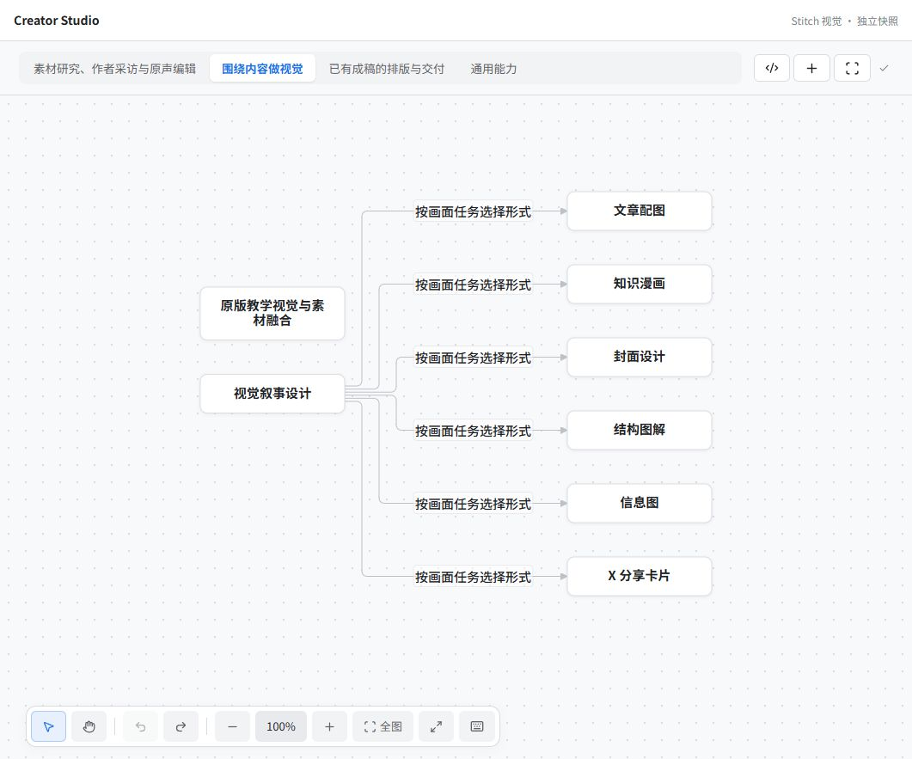
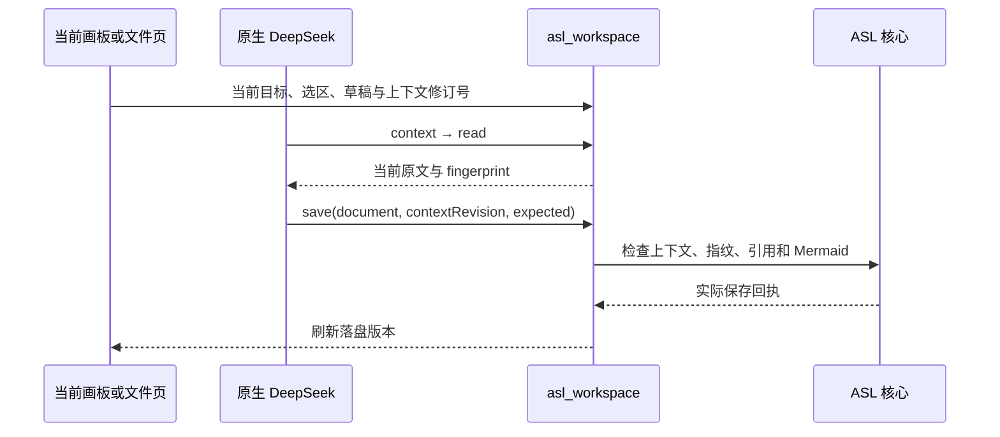

# dsh-asl

**把专业技能组织成 Mode，在 DeepSeek Harness 中围绕内容工作。**

ASL Harness 的 DSH 原生工作区：进入 Mode 就是 Mermaid 技能画板；打开技能进入完整文件树与 Markdown 编辑页。底部输入、右侧回复使用 DeepSeek Harness 原生会话，DeepSeek 与界面通过同一领域服务修改当前内容。



截图来自真实组件及独立示例快照。视觉由 Google Stitch 生成，当前版本 0.3.14，MIT 许可。仓库名是 `dsh-asl`，安装包名保持 `dsh-asl-workspace`。

## 能做什么

- Mode 用途匹配与手动切换；保留已有业务范式和 Mermaid 原文。
- 节点选择、框选、多选、双击改名、拖动连接、复制粘贴、撤销重做、平移缩放和快捷键。节点可关联一至两个技能。
- 完整技能文件页：目录展开收起、Markdown 渲染与编辑，返回上级画板。
- 画框将范围交给原生 DeepSeek 会话；共享 `asl_workspace` 工具支持技能发现、来源检查、采用和内容写回。
- 上下文修订号、原文指纹、草稿保护与核心保存校验，防止旧 Agent 写入覆盖当前编辑。

业务 Mode、Skill 和材料来自你自己的 ASL Environment，本插件不打包私人内容。Mermaid 关系表达技能组织，不代表自动执行的工作流。

## 安装前准备

这是 **ASL Harness 的宿主插件**，需要已有 ASL 核心和 Environment，安装插件本身不会自动创建业务库或安装核心。

1. 安装并能正常运行 DeepSeek Harness。当前验收平台为 Windows 官方桌面版；macOS／Linux 原生宿主尚未实测。
2. 准备 [ASL Harness](https://github.com/qihangzhang-272/asl-harness) 的完整检出目录（含 `desktop/bridge.cjs` 等桥接文件）。建议使用本仓库 `upstream` 固定版本。
3. 准备正式 ASL 核心可执行文件及已有 Environment。没有环境时可复制上游 `examples/personal-environment` 做独立样例；不要把生产库当测试夹具。

```sh
git clone --recurse-submodules https://github.com/qihangzhang-272/dsh-asl.git
```

## 安装预构建包

从 [Releases](https://github.com/qihangzhang-272/dsh-asl/releases) 下载 `.tgz`。退出正在使用插件的 DSH 后，通过官方 CLI 安装；`desktop` 替换为实际 profile 名称。

```sh
dsh plugin --profile desktop add https://github.com/qihangzhang-272/dsh-asl/releases/download/v0.3.14/dsh-asl-workspace-0.3.14.tgz --ignore-scripts
```

仓库也携带预构建 `dist/client.js`，不依赖 postinstall／prepare 脚本：

```sh
dsh plugin --profile desktop add github:qihangzhang-272/dsh-asl --ignore-scripts
```

在该 profile 的 `cordis.patch.yml` 配置插件（使用你机器上的绝对路径）：

```yaml
- id: asl-workspace
  config:
    sourceRoot: C:/path/to/dsh-asl/upstream
    environment: C:/path/to/your-environment
    coreExecutable: C:/path/to/asl-harness.exe
```

`sourceRoot` 指向 ASL 仓库根，不是插件目录。`coreExecutable` 使用带 Mermaid 实际渲染校验的正式核心。也支持 `python` 配置，但需要自行安装 ASL Python 依赖和渲染运行时；不要为通过保存而关闭渲染检查。配置后重启 DSH，进入「ASL 工作区」。会话模型与权限沿用 DSH 本身。

## DeepSeek 如何修改



未保存草稿、目标切换及原文变化会拒绝旧写入。该保护作用于共享工具，不是宿主其他文件工具的沙箱。技能下载不执行安装脚本；采用和改图分步生效，未提供跨文件原子事务。

## 架构与开发

[设计边界与能力矩阵](ARCHITECTURE.md) · [固定上游与同步规则](UPSTREAM.md) · [ASL 总体架构](https://github.com/qihangzhang-272/asl-harness/blob/main/docs/asl-architecture-views.md)

共享编辑器与客户端源码由 `upstream` 子模块固定到已验收提交，本仓库根目录是插件分发投影，运行时继续调用现有 ASL 核心。修改共享能力应先提交 ASL 上游，避免两份实现分叉。

Node.js ≥22.19：

```sh
git submodule update --init --recursive
npm ci --ignore-scripts --legacy-peer-deps
npm run build
npm run test:unit
# 设置 ASL_CORE_EXECUTABLE 为正式核心路径后运行完整集成检查
npm test
npm pack --ignore-scripts
```

发布前已运行 39 项共享组件检查、10 项插件检查（含正式核心真实写入、无效图拒绝、并发与草稿保护），并完成浏览器交互及 Windows DSH 用户验收。其他系统、任意 DSH 未来版本及超大环境不在本次验收范围。

每次工具成功保存后画板刷新；逐 token 填入节点、通用跨系统调度协议仍是后续愿景。问题请附宿主版本、插件版本和去除私人路径／内容后的复现步骤，在 [Issues](https://github.com/qihangzhang-272/dsh-asl/issues) 反馈。
