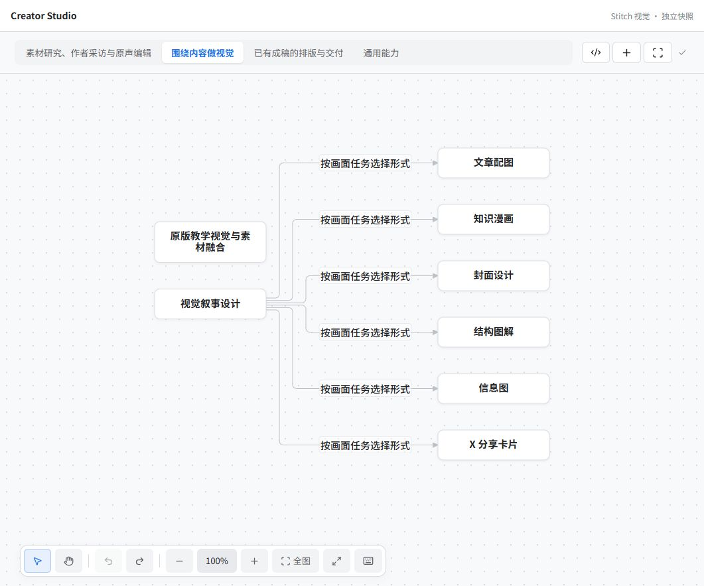
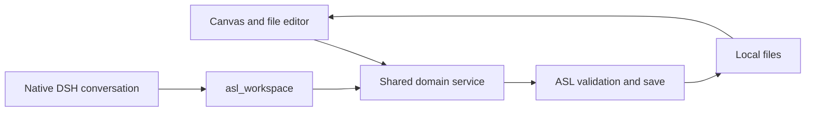

<p align="right"><a href="README.md">简体中文</a> · <strong>English</strong></p>

# dsh-asl

**Give your skills a working context inside DeepSeek Harness.**

Once you have collected a few dozen skills, finding a file is only part of the job. You also need to remember which skills belong together, where the material lives, and how to pick up the work next time.

dsh-asl brings an [ASL Harness](https://github.com/qihangzhang-272/asl-harness) environment into DeepSeek Harness. Choose a Mode, work with its editable Mermaid skill map, open a skill's files, and ask DeepSeek to help with the content you are looking at.



*An example rendered by the actual plugin components. The skills shown depend on your own Environment.*

## A typical session

1. Choose a Mode, or describe your goal to match an existing Mode by its name and purpose. Ambiguous matches remain a choice.
2. Select, rename, move or connect nodes on the Mermaid canvas. You can also edit the source directly.
3. Use the node's open button or `Ctrl+Enter` to enter a full file page: folders on the left, Markdown reading and editing on the right. Return to resume the canvas.
4. Ask DeepSeek to read or change the current file through the native composer. The `asl_workspace` tool reads the latest content and saves through the same service used by the interface.
5. Draw a region to discuss missing skills with DeepSeek. Skill discovery, source inspection and adoption use existing ASL services; the canvas updates after each successful save.

For example, your writing Mode might bring research, interviews, writing and illustration together. Those skills must exist in your environment. The bundled starter example contains only product analysis and source research.

## The pieces

| Piece | Purpose | Location |
| --- | --- | --- |
| Environment | Your lasting collection of skills and work contexts | An ordinary local folder |
| Mode | A recurring working context | `modes/<mode-id>/` |
| Skill | Instructions, scripts, references and templates for a capability | `skills/<skill-id>/` |
| Mermaid canvas | Editable skill relationships and working patterns | `MODE.md`; membership is configured in `mode.yaml` |
| Conversation | Your current task, model and tool execution | Native DeepSeek Harness session |

Edges can describe inputs, feedback or branches. They do not record task execution state or force the agent to follow a fixed sequence. Modes may reference the same skill without making another copy of its files.

## Get started on Windows

Current release: **0.3.15**. Verified with **official Windows x64 DSH 0.2.1-rc.5** and the ASL App 0.5.19 portable core. Native macOS and Linux hosts have not been tested. The declared DSH range is `>=0.2.1-rc.5 <0.3.0-0`; only the version above has been tested. Store or GitHub installs mount safely before local paths are configured and show setup instructions. Reading and editing still require the ASL checkout, core and environment described below.

You need a working DeepSeek Harness installation, Git, an ASL source checkout and an ASL core. The portable core below does not require a separate Python installation or a plugin build.

### 1. Get the source and portable core

Open DSH Desktop once to initialize its profile, then fully quit it. In PowerShell:

```powershell
git clone --recurse-submodules https://github.com/qihangzhang-272/dsh-asl.git
cd dsh-asl
```

If you cloned without submodules, run `git submodule update --init --recursive`. GitHub's Download ZIP does not include the submodule. Check that `upstream/desktop/bridge.cjs` exists.

Download the [ASL App 0.5.19 Windows x64 ZIP](https://github.com/qihangzhang-272/asl-harness/releases/download/app-v0.5.19/ASL-Workspace-0.5.19-Windows-x64.zip), check the [release checksum](https://github.com/qihangzhang-272/asl-harness/releases/tag/app-v0.5.19), and extract the **entire application** to a local application directory. The core is at `ASL Workspace/resources/core/asl-harness.exe`. Keep the whole folder; copying the core EXE alone leaves out its runtime. An existing complete ASL App installation is also suitable.

### 2. Choose an Environment

Use an existing ASL environment, or copy the starter example from the repository root:

```powershell
Copy-Item -LiteralPath ./upstream/examples/personal-environment -Destination ./my-environment -Recurse
```

The example has one `Creator Studio` Mode and two skills. Work in this copy so your experiments do not change the upstream example.

### 3. Install the prebuilt plugin

With DSH still closed:

```powershell
dsh --version
dsh plugin --profile desktop add https://github.com/qihangzhang-272/dsh-asl/releases/download/v0.3.15/dsh-asl-workspace-0.3.15.tgz --config.auto-install-peers=false --ignore-scripts
```

If `dsh` is not on PATH, the verified official desktop distribution provides `resources/runtime/cli/bin/dsh.cmd` under its installation directory. In PowerShell, assign that full path to `$dsh` and use `& $dsh` in place of `dsh`.

The prebuilt package needs no install scripts. Peer packages come from the host; disabling automatic peer installation avoids adding another copy of the DSH foundations. The repository is named `dsh-asl`; the installed package remains `dsh-asl-workspace`.

### 4. Configure three paths

The default profile patch is `%USERPROFILE%/.dsh/profiles/desktop/cordis.patch.yml`, or `$DSH_HOME/profiles/desktop/cordis.patch.yml` when you use a custom DSH_HOME.

Preserve the other entries. Add this item, or update the existing item with the same id. Replace the paths with your own absolute paths:

```yaml
- id: asl-workspace
  config:
    sourceRoot: 'C:/Work/dsh-asl/upstream'
    environment: 'C:/Work/dsh-asl/my-environment'
    coreExecutable: 'C:/Tools/ASL-Workspace-0.5.19/ASL Workspace/resources/core/asl-harness.exe'
```

`sourceRoot` must contain `desktop/bridge.cjs`. `environment` must contain the `skills/` and `modes/` folders. `coreExecutable` is the bundled **core**, not `ASL Workspace.exe`. Use literal paths; YAML does not expand shell variables.

### 5. Open and check it

Launch DSH through its desktop application, then open **ASL 工作区** in the sidebar. Do not try to boot its managed `desktop` profile with `dsh --profile desktop`; the desktop CLI reserves that startup for the application.

The starter example should offer `Creator Studio` with the product analysis and shared-capability diagrams. Open a skill, edit a small piece of text, save and reread it. Try a diagram label change as well.

Once a working model is configured in DSH, ask:

> Use asl_workspace: first context, then read the current file. Summarize its purpose without changing it.

Then ask for a small edit through the same tool and check the saved result. Save or discard any local draft before asking the model to write. The model and tool approval settings are managed by DSH.

The [installation and troubleshooting guide](docs/INSTALLATION.md) is currently in Chinese. It covers path checks, missing native chat, file conflicts, updates and removal. If Mermaid saving fails with `0x80000003`, try the complete ASL App in an independent local directory and update the core path; a directory-related failure occurred during rehearsal. Do not bypass rendering validation.

## How changes reach your files



Before writing, the shared tool checks the current target, context revision, original fingerprint and draft state. The ASL core validates references, file boundaries and Mermaid rendering. A successful save causes the interface to reread the content.

This protects against stale writes through the shared tool. Other host file tools remain governed by DSH; the plugin does not provide an operating-system sandbox. Selecting a workspace Mode also does not automatically rewrite DSH's global skill-discovery roots. See [ARCHITECTURE.md](ARCHITECTURE.md) for the exact boundary between ASL's broader framework and this plugin.

## Canvas controls

Click to select, double-click or press `F2` to rename, and use the node's open button or `Ctrl+Enter` to enter its files. Use `Shift` for multiple selection, `V`/`H` for select/pan, Space-drag to pan, and `Ctrl+wheel` to zoom. `Shift+1` fits the diagram, `Shift+0` returns to actual size, and `?` opens shortcut help.

Flowcharts support multi-node movement, copying, pasting and duplication. Other Mermaid types retain their own structure-editing behavior. Text editing and IME input keep their usual shortcuts. macOS mappings exist but have not been verified in a native host.

## Scope and development

Skill discovery needs network access. Downloading a skill does not run its install scripts. Adoption and diagram changes are separate saves, without a cross-file transaction. The canvas refreshes after successful saves; token-by-token node generation and general cross-system orchestration remain future work.

The `upstream` submodule pins the shared client and editor source. The root contains the installable projection and prebuilt client. Shared changes belong in ASL first; see [UPSTREAM.md](UPSTREAM.md).

With Node.js ≥22.19:

```sh
git submodule update --init --recursive
npm ci --ignore-scripts --legacy-peer-deps
npm run build
npm run test:unit
npm pack --ignore-scripts
```

Set `ASL_CORE_EXECUTABLE` to a complete ASL App's core and run `npm test` for integration checks. There are 47 unit checks, or 48 including the real core integration. CI runs the build, unit checks and packaging. [Verification notes](docs/VERIFICATION.md) distinguish release, installation and native-host evidence.

Report issues with your OS, DSH version, plugin version and reproduction steps. Remove credentials and private content from logs before posting.

[MIT](LICENSE). Built on the same author's ASL Harness; visual styling was generated with Google Stitch. This is an independent community plugin.
